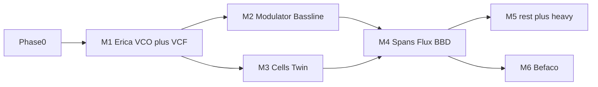

# Open hardware / open source modules — build plan

## Fit rules

- **Circuit track:** CC-BY-SA schematics → netlist / MNA or specialized DSP → ngspice when useful → rack module + faceplate. Pattern: Erica Mixer/Output.
- **Firmware track:** MIT DSP from `third-party/eurorack` → `emenay-mi-host` → Rust wrapper + UI. Always **rename** (Facets/Lots pattern).
- **Skip:** Daisy/Teensy shields, meters, NC-only HW, trademark panel clones, generics with no schematic/firmware win.

## Baseline (done)

Erica-inspired Mixer / Output / Envelope / Dual VCA · Facets / Lots / Swell / Chimes / Twist · generics (VCO, VCF, LFO, sequencers, MIDI→CV, drums, delay/reverb, utilities).

## Phase 0 — Hygiene

- Pin eurorack submodule on the NaN-guard commit for clean clones
- Public docs: attribution only (no MI product-name marketing)
- Per module: `type_id`, faceplate, panel hits, smoke test, preset when it unlocks a new patch style

## Phase 1 — Erica DIY (CC-BY-SA)

Source: [erica-synths/diy-eurorack](https://github.com/erica-synths/diy-eurorack).

| # | Module | Why |
|---|--------|-----|
| 1 | **VCO3** | Sync + Polivoks voice core vs SimpleVco |
| 2 | **Polivoks VCF** | Signature filter; pairs with VCO3 |
| 3 | **Modulator** | LFO + noise + S&H; completes Erica utility set |
| 4 | **Bassline** | Acid voice; reuse VCO/VCF/env stages |
| 5 | **BBD** | Analog FX character vs current delay |
| 6 | **Swamp** | Chaos / Wogglebug-style CV |
| 7 | **Erica Delay** | Different flavour vs digital Delay (BBD-ish / DIY character) — variety wins, not “better” |

Exit: audible, usable faceplate, attribution clear, `make check` green.

## Phase 2 — Firmware hosts (MIT, rename)

| # | Upstream | Draft emenay name | Role |
|---|----------|-------------------|------|
| 1 | grids | **Cells** | Drum pattern brain |
| 2 | peaks | **Twin** ✅ | Dual EG / LFO / 808 drums |
| 3 | stages | **Spans** | Segment generator |
| 4 | streams | **Flux** | Dual dynamics |
| 5 | edges | **Quads** | Chiptune bank |
| 6 | frames | **Keys** | Keyframer / mixer |
| 7 | branches | **Forks** | Bernoulli gates |

Exit: 48 kHz host builds, smoke test, catalog name ≠ MI trademark.

## Phase 3 — Heavy firmware (committed)

Overlap with existing modules is fine — modular thrives on different colours of the same idea.

| # | Upstream | Draft emenay name | Role |
|---|----------|-------------------|------|
| 1 | clouds | **Nebula** (draft) | Texture / granular |
| 2 | elements | **Relic** (draft) | Modal synth |
| 3 | braids | **Strands** (draft) | Macro oscillator palette (alongside Facets) |

## Phase 4 — Other OHW (committed)

- Befaco Even VCO / Rampage-class: license check + rename, then ship a pilot (not “optional”)

## Remaining queue (11)

Erica Delay · Cells · Spans · Flux · Quads · Keys · Forks · Nebula · Relic · Strands · Befaco pilot.

## Milestones

| Milestone | Deliverable |
|-----------|-------------|
| **M1** | VCO3 + Polivoks VCF ✅ (`erica_vco3`, `erica_polivoks_vcf`) |
| **M2** | Modulator + Bassline ✅ (`erica_modulator`, `erica_bassline`) |
| **M3** | Twin (Peaks) ✅ (`twin`); **Cells** (Grids) still open |
| **M4** | BBD + Swamp ✅; **Spans + Flux** still open |
| **M5** | Quads / Keys / Forks + Erica Delay |
| **M6** | Nebula + Relic + Strands (heavy firmware) |
| **M7** | Befaco pilot |

## Per-module checklist

1. License + rename noted in PR
2. Path: circuit vs firmware vs compose-existing
3. Faceplate triad (all required — CI enforces via `npm run check:faceplates`):
   - SVG under `apps/web-ui/public/panels/fm/`
   - `PANEL_ART` entry in `panels.ts`
   - `PANEL_LAYOUTS` hits in `panelLayouts.ts` (mm coords matching the SVG)
   - For emenay-authored plates: add a theme in `scripts/render-emenay-faceplates.mjs` and run `npm run faceplates:render`
4. Factory + `catalog_type_ids()` registration
5. Smoke test (+ spice if circuit)
6. **MIDI test preset** (`MIDI <Name>`) — midi_cv → module under test → env/VCA → out
